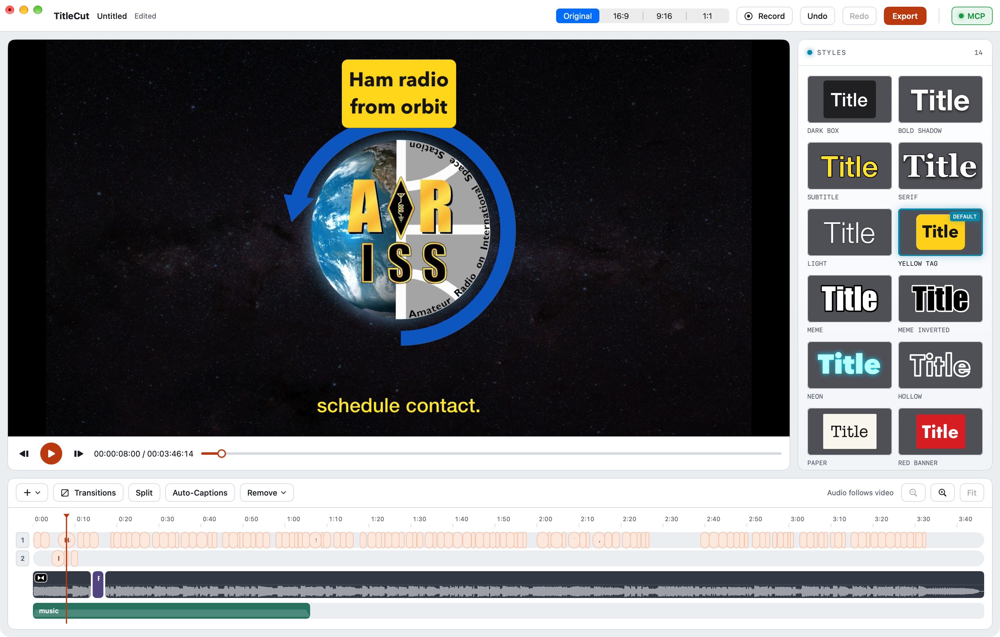
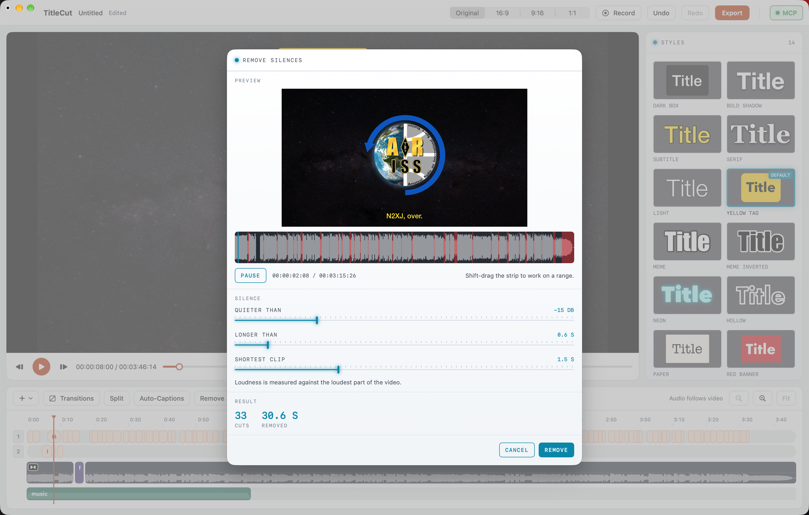
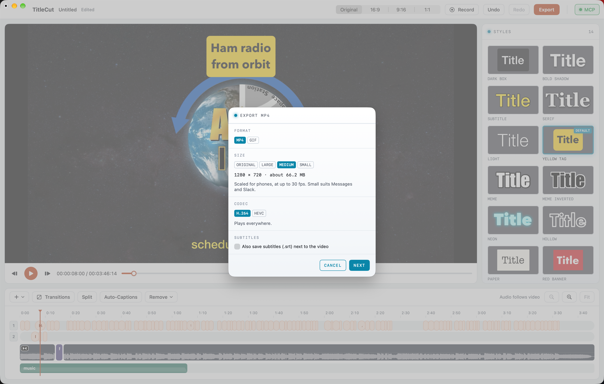
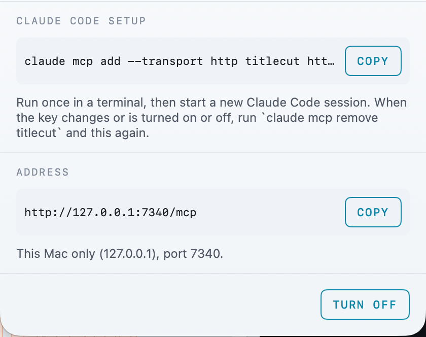

# TitleCut

A native macOS app that adds timed titles, captions, freeze frames and camera moves to a video and exports it to MP4 or GIF.

## Screenshots









## Features

**Titles**

- Timed text titles with a style library (Dark Box, Bold Shadow, Subtitle, Serif, Neon, Meme and others).
- In and out motions: none, fade, slide, scale, typewriter.
- Per-title font, weight, colour, outline, box, shadow, alignment and position.

**Captions**

- Auto-captions from on-device speech recognition. No cloud service is used.
- Word highlight in captions.
- Export of captions as an `.srt` file, saved beside the MP4.

**Cutting**

- Remove Silences with a live preview. Settings: quieter-than threshold, longer-than duration and shortest kept clip. Shift-drag the strip to limit the work to a range. All cuts apply as one undo step.
- Remove Filler Words (um, uh, er, ah, hmm), based on the transcript.
- Split, trim and move clips. Add more videos to the timeline.
- Clip speed 0.5x to 10x, with pitch preserved for speech. Clip volume 0 to 2.

**Stills and cards**

- Freeze frames with a set length.
- Still images dropped onto the timeline.
- Camera moves on stills (Ken Burns): start from the whole frame, move to a chosen centre and zoom, hold, with a choice of pace.
- Title cards: solid colour segments for titles.

**Transitions**

- Dip to black, dip to white and crossfade at cuts. Dips also work at the start and end of the video.
- Length 0.1 s to 5 s. A transition never changes the video length.

**Framing**

- Output shapes: 16:9, 9:16, 1:1 and Original.
- Per-clip framing: position and zoom (1x to 6x).
- Face framing: centres the largest face in each clip and splits the clip where the face moves.
- Split screen: two framed halves of one clip, stacked or side by side depending on the shape.

**Audio**

- Background music strip with start, trim, volume and fade in and out per piece.
- Screen recording (Record Screen), added to the timeline.

**Export**

- MP4 with H.264 or HEVC.
- Sizes: Original, Large (1920 px longest side), Medium (1280 px), Small (960 px). The scaled sizes cap the frame rate at 30 fps. The export sheet shows an estimated file size.
- Animated GIF: width 320, 480 or 720 px, 10, 15 or 24 fps, loop or play once. Also shows an estimated size.

**MCP server**

- An MCP server built into the app lets Claude Code drive the running window. See [Claude Code / MCP setup](#claude-code--mcp-setup).

## Requirements

- macOS 26.0 or later.
- Xcode 26 or later with Swift 6 (strict concurrency is on).
- [XcodeGen](https://github.com/yonaskolb/XcodeGen).

Package dependency, fetched by Xcode: [MCP Swift SDK](https://github.com/modelcontextprotocol/swift-sdk) 0.12.1.

## Build

The `.xcodeproj` is generated from `project.yml` and is not committed.

```sh
brew install xcodegen
xcodegen generate
open TitleCut.xcodeproj
```

Command line:

```sh
xcodebuild -project TitleCut.xcodeproj -scheme TitleCut -configuration Release build
```

The Debug configuration is signed with a specific development certificate and team in `project.yml`. To build Debug on another machine, change `CODE_SIGN_IDENTITY` and `DEVELOPMENT_TEAM` under `settings.configs.Debug`, or build Release, which is ad-hoc signed.

The app is sandboxed. See `App/TitleCut.entitlements`.

## Tests

```sh
xcodegen generate
xcodebuild test -project TitleCut.xcodeproj -scheme TitleCut -destination 'platform=macOS'
```

The `CoreTests` target covers the model, timeline math, rendering, export sizes and project commands.

## Claude Code / MCP setup

TitleCut runs an MCP server over HTTP on `127.0.0.1`, default port 7340. Every edit made through MCP appears in the open window and is one undo step.

1. Start TitleCut.
2. Click the MCP button in the top bar. This starts the server and opens a panel.
3. Copy the command under "Claude Code setup" and run it once in a terminal. It has this form:

   ```sh
   claude mcp add --transport http titlecut http://127.0.0.1:7340/mcp
   ```

4. Start a new Claude Code session.

The panel can require a key. When it is on, the setup command includes an `Authorization: Bearer` header, and calls without the key are refused. When the key changes, or key use is turned on or off, run `claude mcp remove titlecut` and the new command.

The server listens on the local machine only.

### Tools

Call `get_instructions` first. It returns the full manual. Tools include:

- Session: `list_projects`, `get_project`, `new_project`, `undo`, `redo`, `save`
- Video: `open_video`, `add_video`, `set_shape`, `seek`, `play`, `pause`
- Clips: `split_at`, `trim_segment`, `move_segment`, `set_clip`, `set_framing`, `set_split`, `frame_faces`
- Stills: `freeze_frame`, `set_camera`, `insert_card`, `set_transition`
- Titles: `list_styles`, `add_title`, `update_title`, `set_titles_style`
- Captions: `auto_captions`, `get_transcript`, `export_subtitles`
- Cuts: `find_silences`, `remove_silences`, `find_fillers`, `remove_fillers`
- Music: `add_music`, `update_music`
- Output: `render_frame`, `export`, `job_status`

`auto_captions` and `export` return at once. Poll `job_status` for the result.

### Folders permission

TitleCut is sandboxed. macOS lets a sandboxed app open a file only after the person has chosen it, in an Open panel or by dragging it in. A path sent over MCP is not a choice.

The MCP panel has a Folders section. Adding a folder chooses everything in it at once. Claude can then open videos and songs from that folder and save exports to it. The Movies and Music folders are allowed from the start. Files opened by hand work from any folder.

`open_video`, `add_video`, `add_music`, `export` and `export_subtitles` take absolute paths inside these folders.

## Project layout

- `App/` - application target: windows, top bar, MCP server (`App/MCP`), screen recording, MCP panel.
- `Core/` - `TitleCutCore` framework: project model, timeline, composition, rendering, captions, framing, export, persistence.
- `UI/` - SwiftUI and AppKit views: timeline, preview, inspector, silences, captions, stills, export.
- `Tests/` - unit tests (`CoreTests`) and fixtures.
- `DemoKit/` - demo media and a walkthrough that exercises every feature by hand and over MCP (`DemoKit/README.qmd`).
- `StoreKit/` - StoreKit configuration file used for local purchase testing from Xcode.
- `project.yml` - XcodeGen project definition.
- `PLAN.qmd` - design plan.

## License

MIT. See [LICENSE](LICENSE).
